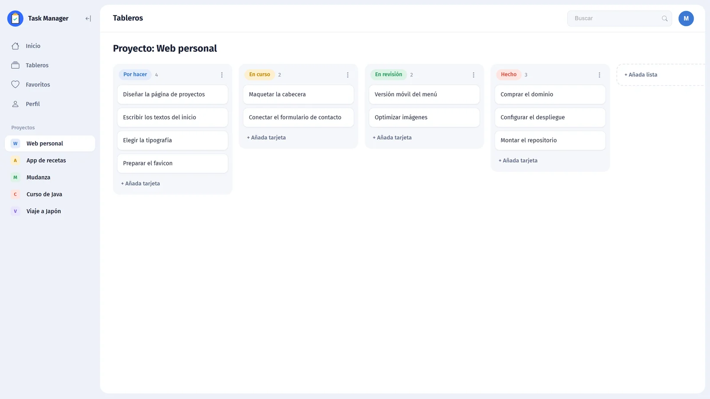
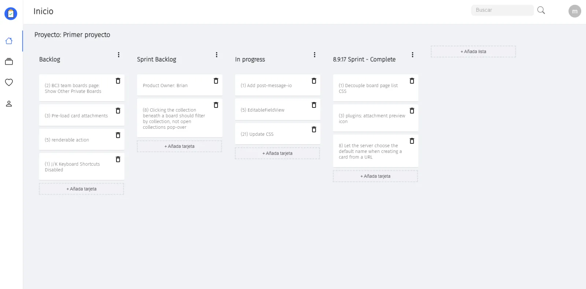
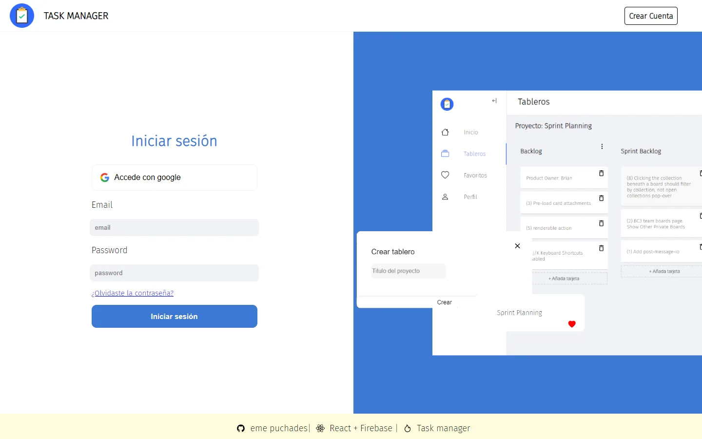
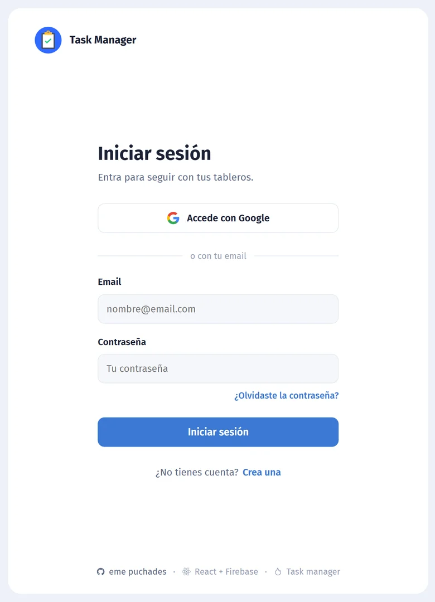
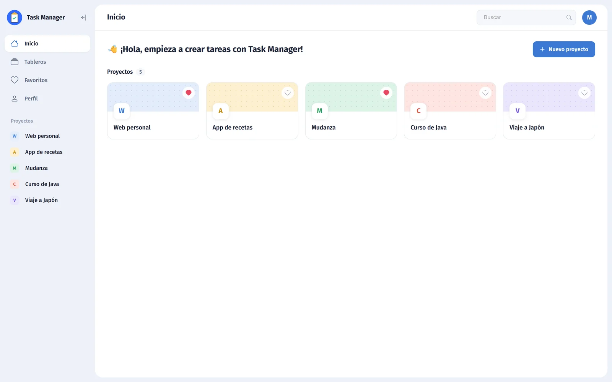

# Task Manager

> My first complete web app (2022), redesigned in 2026. Kanban boards for small projects, with Google or email sign-in and data in the cloud.

**Live demo:** https://task-manager-mp.vercel.app · UI in Spanish



## Why this repo exists

I built Task Manager in 2022 while learning React: it was my first app with real users, authentication and a database. In 2026 I went back to it with four more years of experience and gave it a proper design pass, keeping the original idea and the Firebase backend.

It stays public as it is, with its history, because it shows the distance between where I started and how I work now.

## Then and now

| 2022 | 2026 |
| --- | --- |
|  |  |
|  |  |



**Where it started**

- Create React App as the base.
- Four UI libraries at once: MUI 4, MUI 5, React Bootstrap and styled-components.
- Default component styles, no palette and no spacing system.
- Global state in Redux with redux-persist.

**What the 2026 pass changed**

- A design system of its own: colour palette, spacing and typography tokens.
- New layout: sidebar with your projects and the content inside a single panel.
- Home with project cards, covers, a favourites counter and empty states.
- Kanban columns redesigned, with a colour per status and a card counter.
- New login screen, profile form, alerts and loading states.
- New-project modal with column templates, and every project keeps its own lists.

**What I would do differently today**

- One UI library, chosen before writing the first component.
- Tokens first, components second. Doing it the other way round is what made the 2022 version inconsistent.
- Less global state: most of what lived in Redux belongs to the component that uses it.

## Features

- Projects with Kanban boards: lists and cards you drag between columns.
- Column templates when you create a project.
- Favourites, covers and empty states that tell you what to do next.
- Sign in with Google or with email and password.
- Projects, lists, cards and favourites stored per user in Firestore.

## Tech stack

| | |
| --- | --- |
| UI | React, React Router, MUI, styled-components |
| State | Redux Toolkit, redux-persist |
| Backend | Firebase Authentication and Firestore |
| Drag and drop | react-beautiful-dnd |
| Tooling | Create React App, ESLint, Prettier |

## Getting started

The app needs a Firebase project of your own. Five minutes:

1. Go to [Firebase](https://firebase.google.com/), create a project (Analytics is optional) and register a web app ([steps](https://firebase.google.com/docs/web/setup)).
2. In **Authentication**, enable two sign-in methods: **Google** and **Email/Password**.
3. In **Firestore Database**, create a database in test mode.
4. Copy `.env.example` to `.env` and paste the keys of your web app. They are read in `src/firebase.js`:

```javascript
const firebaseConfig = {
    apiKey: process.env.REACT_APP_APIKEY,
    authDomain: process.env.REACT_APP_AUTHDOMAIN,
    projectId: process.env.REACT_APP_PROJECTID,
    storageBucket: process.env.REACT_APP_STORAGEBUCKET,
    messagingSenderId: process.env.REACT_APP_MESSAGINGID,
    appId: process.env.REACT_APP_APPID,
}
```

Then install and run. The app opens at http://localhost:3000.

```bash
npm install
npm start
```

## Contributing

Issues and pull requests are welcome. See [CONTRIBUTING.md](CONTRIBUTING.md).

## License

[MIT](LICENSE) · Made by [María Puchades](https://github.com/emepuchades)
